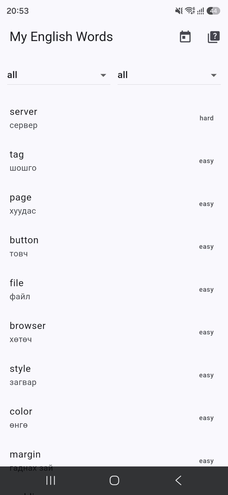
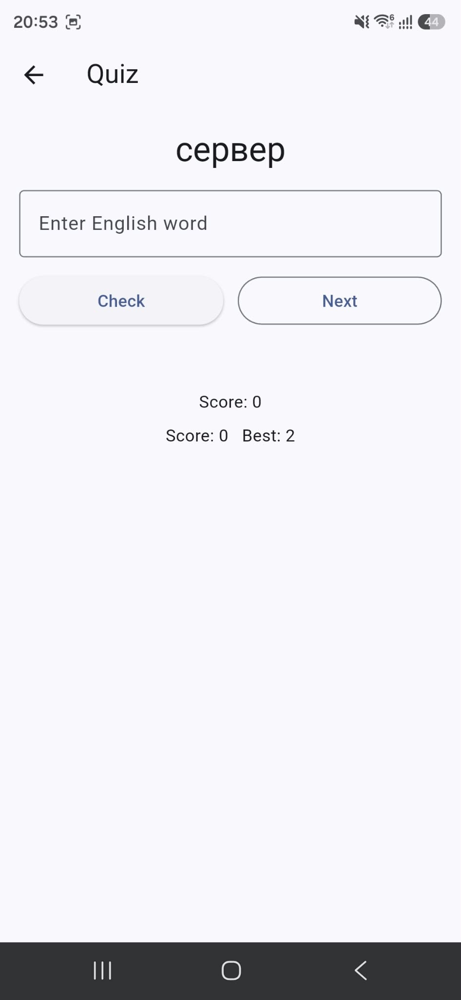
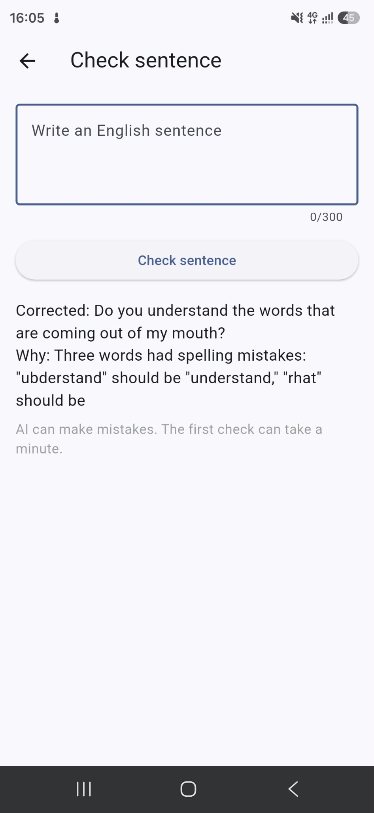

# English Words App

A Flutter app that helps software developers learn English words.
It loads words from a REST API and tests your knowledge with a quiz.

## Features
- Load words from a Spring Boot API
- Filter words by category and level
- Take a quiz and check your answers
- Daily 5: a quiz with five new words every day
- Save your best score on the phone
- Check your English sentences with AI

## Tech stack
- Flutter and Dart
- `http` package for GET and POST requests
- `shared_preferences` for local storage

## Backend
The app uses the [Words API](https://github.com/Davaador/words-api),
a REST API built with Spring Boot and PostgreSQL.
The backend also calls the Claude API to check sentences.

## Run locally
    flutter pub get
    flutter run

To build an Android release file:

    flutter build apk --release

## Screenshots

## Note
The API runs on a free hosting plan. The first request can be slow
because the server may be asleep.
The AI can make mistakes. Please check its answers.
The AI checker has a limit of five requests per minute.